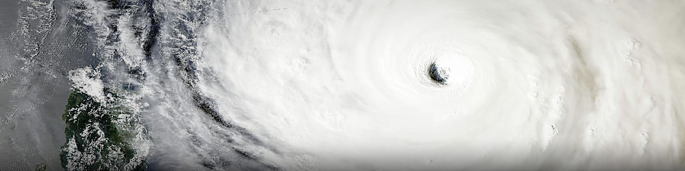

Supertyphoon Champi · 2026-10-21 · MODIS/Aqua True Color · NASA GIBS

# 碳基12

**脚踏实地，仰望星空**

*Rooted on Earth, reaching for the stars.*

 

  <a href="#about">关于 About</a> ·
  <a href="#research">研究与经历 Research</a> ·
  <a href="#engineering">工程 Engineering</a> ·
  <a href="#orgs">组织 Organizations</a> ·
  <a href="#toolbox">工具箱 Toolbox</a>

---

<em>“地球是人类的摇篮，但人类不可能永远生活在摇篮里。”</em>

<em>— 康斯坦丁·齐奥尔科夫斯基</em>

<em>"The Earth is the cradle of humanity, but mankind cannot stay in the cradle forever."</em>

<em>— Konstantin Tsiolkovsky</em>

---

## 关于 / About

研究主线为**遥感反演方法**：从有限的观测信号中，稳健地还原物理量。

海面的粗糙度与波谱、平流层的云与气溶胶、行星大气的散射与辐射收支——**问题不同，方法同源**。海洋与大气的星载观测是这条主线的验证场，行星探测则是它在尺度上的延伸。

My research centers on **remote-sensing retrieval**: inferring physical variables, robustly, from limited observations.

Sea-surface roughness and wave spectra, stratospheric cloud and aerosol fields, planetary atmospheric scattering and radiation budgets: **distinct problems, a shared methodology**. Satellite observations of the ocean and atmosphere serve as its proving ground; planetary exploration carries it across scales.

### 关注领域 / Fields

<table align="center">
  <tr>
    <td align="center" width="240">
      <h3>🌊 海洋</h3>
      <em>Ocean</em>  
      海面粗糙度与波谱 
      星载激光雷达观测
    </td>
    <td align="center" width="240">
      <h3>☁️ 大气</h3>
      <em>Atmosphere</em>  
      云与气溶胶场 
      散射与辐射收支
    </td>
    <td align="center" width="240">
      <h3>🪐 行星</h3>
      <em>Planetary</em>  
      大气散射与辐射 
      尺度上的延伸
    </td>
  </tr>
</table>

---

## 研究与经历 / Research & Experience

- **星载单光子激光雷达海面风速反演**（在研）—— 基于 ICESat-2 / ATL03 光子点云：去噪与海面信号提取、波形参数反演，联合海面均方斜率与波谱特征建立风速模型，并与 GNSS-R（CYGNSS）产品交叉验证。
   <em>Spaceborne single-photon lidar retrieval of sea-surface wind speed (in progress) — built on ICESat-2 / ATL03 photon point clouds: denoising and sea-surface signal extraction, waveform-parameter inversion, and a wind-speed model driven by mean square slope and wave-spectrum features, cross-validated against GNSS-R (CYGNSS) products.</em>
- **北京大学地球科学夏令营**（2024）· 地球系统科学方向
   <em>Peking University Earth Science Summer Camp (2024) — Earth System Science</em>
- **CESO 2024** · 金奖 · 全国第 41
   <em>CESO 2024 (Chinese Earth Science Olympiad) — Gold Medal, 41st nationally</em>

---

## 工程 / Engineering

- **DeepSeek Harness 插件开发** —— Host / Client 双侧插件，TypeScript 与 Cordis 依赖注入，自定义 UI Slot 与 patcher 层加载。
   <em>DeepSeek Harness plugin development — host- and client-side plugins in TypeScript, with Cordis dependency injection, custom UI slots and patcher-layer loading.</em>
- **遥感数据处理流水线** —— 光子级点云处理、沿轨剖面重建与波数谱分析，以全流程可复现、结果可验证为工程准则。
   <em>Remote-sensing data pipeline — photon-level point-cloud processing, along-track profile reconstruction and wavenumber spectral analysis, engineered for reproducibility and verifiability.</em>

---

## 组织 / Organizations

<table align="center">
  <tr>
    <td align="center" width="400">
      
        
      <a href="https://github.com/Supercell-Hunter"><strong>Supercell Hunter</strong></a>
       
      <em>粤气爱追风小队</em>
        
      成立于 2025 年，追逐强对流、台风与锋面， 
      记录并传播华南的激烈天气。
       
      <em>Founded in 2025 · chasing severe convection, typhoons and fronts across Guangdong.</em>
        
      
    </td>
  </tr>
</table>

---
### 此刻 / Now

<table align="center">
  <tr>
    <td align="center" width="240">
      <h3>🔭 在研</h3>
      <em>Researching</em>  
      ICESat-2 海面风速反演 
      光子点云 → 波谱特征 → 风速
    </td>
    <td align="center" width="240">
      <h3>🧩 在写</h3>
      <em>Building</em>  
      DeepSeek Harness 插件 
      Host / Client 双侧，TypeScript
    </td>
    <td align="center" width="240">
      <h3>📖 在学</h3>
      <em>Learning</em>  
      遥感反演方法 
      与可复现的数据工程
    </td>
  </tr>
</table>

---

## 工具箱 / Toolbox

### 💻 语言 / Languages

### 🔬 科学计算 / Scientific Computing

### 🛰️ 遥感 / Remote Sensing

### ⚙️ 工程 / Engineering

### 🖥️ 环境 / Environment

---

© 2026 碳基12 · Banner: NASA GIBS / MODIS-Aqua · Made with Markdown, satellite imagery and patience.

